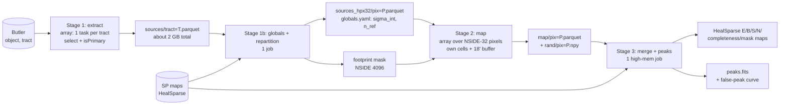

# Full-footprint DP2 aperture-mass maps on S3DF: Design Plan

| | |
|---|---|
| **Project** | dp2-clusters-shear-mapping |
| **Author** | Alex Broughton (draft by Claude) |
| **Status** | Draft |
| **Last updated** | 2026-10-20 · v0.3 (Step 0 is now a test plan; nothing is implemented) |

## TL;DR

Split the run into four Slurm stages that pass small files between them. (1) **Extract:** read each tract's object table **once**, apply the cuts, and write a slim source catalog of about 2 GB in total. (2) **Repartition** that catalog into coarse HEALPix pixels (NSIDE 32, NEST). (3) **Map:** each coarse pixel evaluates only the NSIDE-4096 cells it *owns* and reads an 18′ buffer of sources from its neighbors, so work-unit edges cannot produce artifacts. (4) **Merge:** combine everything into HealSparse maps on the same grid as the DP2 survey-property maps, then run peak finding once over the whole map.

The map computation is cheap, about 5–50 core-hours. The real costs are I/O and memory when reading the object tables, so a 20-tract profiling pilot comes first.

## Your four questions, answered in short

| Question | Answer in this plan |
|---|---|
| 1. Running on S3DF | Slurm **job arrays** on `roma`, with one file per work unit and skip-if-done, so a failed unit can simply be resubmitted. No `multiprocessing.Pool` spanning the whole footprint (see the Current state section for why the last run hung). |
| 2. Resource use | Estimated from runs you already did (Resource estimates section), then **measured** in a 20-tract pilot with `sacct MaxRSS` before the full run. The compute is small. Memory per tract read is the unknown that matters. |
| 3. One tract at a time and overlaps | Read one tract at a time **only in the extraction stage**. Duplicates in the overlap regions are removed with `detect_isPrimary` (this needs verifying, see R1). Edges are handled by **cell ownership plus an 18′ (θ_max) source buffer**. Only real survey edges remain, and the completeness mask and the random-rotation maps handle those. |
| 4. What the output should be | The same products large surveys release: **HEALPix maps** (E, B, S/N, weight, completeness, mask), **noise realizations**, and a **peak catalog** with a false-detection rate measured from the randoms. DES Y3 released NSIDE-1024 HEALPix mass maps. HSC released a shear-selected catalog of 129 peaks at S/N ≥ 4.7 drawn from aperture-mass maps. Details are in the Outputs section. |

## Motivation

`notebooks/dp2-shear-map-tract.ipynb` produces correct E/B aperture maps and peaks for a single tract. The paper needs maps of the whole DP2 footprint so that we can:

- correlate the E/B maps with the survey property maps (PSF size and ellipticity, depth, and so on), which are HealSparse maps;
- cross-match peaks with external optical, X-ray, and SZ cluster catalogs;
- publish a peak catalog above an S/N threshold with a quantified false-detection rate.

Running the tract notebook 1,546 times does not get us there. The per-tract constants differ from tract to tract, which produces seams (see the Edge handling section). Each neighbor table is re-read about 8 times. Peaks near tract edges are found twice or not at all. Finally, the closest existing batch job (`sky_coverage.py`) did not finish on the full footprint.

## Goals and non-goals

**Goals**
- E/B aperture-mass and S/N maps over every DP2 tract with selected sources, with **no visible seams at tract or work-unit boundaries**. Checkable: the maps do not depend on how the sky is partitioned (see the Validation section).
- One global peak catalog, plus false-peak rate as a function of S/N from K random-rotation realizations.
- Outputs on the HEALPix grid used by the DP2 survey property maps, so that correlating with them is a pixel join.
- A rerun from scratch takes less than one working day of wall time, and any single unit can be rerun on its own.
- One shared selection/config module used by every script and notebook, replacing the three hand-copied versions in use today.

**Non-goals**
- Kaiser–Squires or any other κ reconstruction, and multiple estimators. The README fixes a single estimator.
- Re-tuning Rs, x_c, NSIDE, or the cuts. These are frozen from the tract notebook for v1, and the code allows them to be changed later.
- Switching to metadetect shapes. Stage 1 isolates the shape columns so that switching later is a config change, but it is not part of this plan.
- The SP-correlation and cross-match analyses. This plan only produces their inputs.
- Turning this into a Rubin `PipelineTask`/BPS workflow.

## Current state

- **Map code** lives in `notebooks/dp2-shear-map-tract.ipynb` and is papermill-ready. It runs `selection_mask` → `neighbor_tract_ids` (sources from neighbors within the tract's bounding circle plus θ_max) → `run_aperture_map` (a loop over occupied NSIDE-4096 RING cells, using a flat (RA, Dec) `cKDTree`) → `find_peaks_shear_healpix`. The parameters are Rs = 15′, x_c = 0.15, search radius 1.2 Rs = 18′, `N_RANDOM` = 10, peaks at S/N ≥ 4, completeness ≥ 0.8, and exclusion radius 0.4 Rs.
- **The selection** is copied by hand into the tract notebook, `python/sky_coverage.py`, and `notebooks/dp2_tract_stats.ipynb`. It uses `detect_isDeblendedModelSource` and **never uses `detect_isPrimary`**, and nothing else in the repo does either.
- **Several quantities are computed per tract:** `N_DENSITY` (the completeness normalization), `SHAPE_NOISE_E` (which sets the weights), the random-rotation seed (`default_rng(42)`), and the `E2_SIGN` frame (per-tract WCS).
- **Measured scale** (`output/dp2_shapehsm_tract_stats.ecsv`):
  - 2,177 object tracts, 2,164 of them readable; 8.0×10⁸ objects in total.
  - 1,546 tracts have any selected galaxies, for 4.86×10⁷ selected galaxies.
  - The median density is only 1.7 gal/arcmin². Only 319 tracts (about 770 deg²) reach 5 gal/arcmin², and 86 (about 210 deg²) reach 10.
  - Dec ranges from −51° to +14°. **80 tracts with galaxies sit at the RA = 0/360 wrap.**
- **Batch experience** (`sh/run_sky_coverage.sh` → `output/coverage_slurm.*`): a single `multiprocessing.Pool(16)` on `roma` processed about 1 tract per process-minute. After 2,011 of 2,032 tracts it was killed at the 4 h limit, with **21 `oom_kill` events**. When a `Pool` worker is OOM-killed, its task is lost and `pool.map` waits forever. That is why the job hung until the time limit. In the same script, `--nodes=2` wastes a node, because a Pool only runs on one, and `# SBATCH --mem` is commented out by the space.
- **Saved outputs** show "Neighbor tracts: none" for both test tracts (9813 via the Butler, 2877 via a local table). The neighbor-buffer code path has therefore not been tested on real neighbors.

## Proposed design



### Stage 1: extract (one tract at a time, read once)

`python/run_extract.py --tract T` (a Slurm array over the tract list) does the following:

- reads the `object` table with `parameters={"columns": ...}`;
- applies the shared `selection_mask` and **`detect_isPrimary`**;
- writes `sources/tract=T.parquet` with the columns `objectId:i8, ra:f8, dec:f8, e1:f4, e2_pix:f4, sigma_e:f4, tract:i4`, plus space for `zphot:f4`.

It also writes `extract_summary/tract=T.json`, which holds the row counts after each cut, the elapsed time, and the **peak RSS** (from `resource.getrusage`).

The stage stores **raw** e1/e2 and σ_e. The calibration (R, m), the frame flip, and the weights are applied later, so changing them never requires re-reading the Butler. The output is about 48.6×10⁶ rows × about 40 B ≈ 2 GB in total.

### Stage 1b: global constants and repartition (single job)

This stage loads all of the slim catalogs (about 2 GB) and does three things:

- **Global constants:** it computes `SHAPE_NOISE_E` once for the whole survey and writes it to `globals.yaml` together with R, m, Rs, x_c, NSIDE, the git hash, and the collection. Every unit then uses identical weights.
- **Footprint mask at NSIDE 4096:** a cell is in the footprint if the i-band coadd covers it. This comes from a DP2 SP map degraded to 4096 (for example `deepCoadd_psf_maglim_consolidated_map_weighted_mean`), *not* from "contains a selected galaxy". At 1.7 gal/arcmin² and 0.74 arcmin² per cell, the current occupied-cell rule leaves many holes in shallow regions.
- **Repartition:** it adds `hpx32 = ang2pix(32, ra, dec, nest=True, lonlat=True)` and writes `sources_hpx32/pix=P.parquet`. Each NSIDE-32 pixel covers 3.36 deg² (about 1.8° across).

### Stage 2: map one coarse pixel (cell ownership + buffer)

`python/run_map.py --pix P [P ...]` (a Slurm array in which each element takes a list of pixels) does the following:

- **Ownership:** unit P evaluates exactly the NSIDE-4096 NEST cells with `ipix >> 14 == P` (because 4096/32 = 2⁷, giving 14 bits) that are inside the footprint mask. Every cell has exactly one owner, so the merge is a concatenation with no deduplication.
- **Buffer:** it loads P plus `hp.get_all_neighbours(32, P, nest=True)`, which covers 1.8° on each side, far more than the 0.3° needed. It keeps only the sources within θ_max of P's cells. Sources come from *all* tracts, so tract boundaries play no role here.
- **Geometry:** it builds the `cKDTree` on **3-D unit vectors** and queries with chord radius 2 sin(1.02 θ_max/2). The 2% pad keeps the search a superset of the kernel's flat-sky aperture. This removes both the RA-wrap bug and the 1/cos(dec) widening. The kernel itself (`aperture_mass_and_sn_at_center`, `gamma_tx_sky`, `schirmer_weight`) moves unchanged into `python/shearmap/aperture.py`. The kernel computes `ra - ra_c` too, so `evaluate_cells` unwraps RA around each cell center before calling it (`wrap_ra_near`).
- **Random rotations, deterministic per galaxy:** angle_k = `splitmix64(objectId, k)` mapped to [0, π). A galaxy then gets the same rotation in every unit whose buffer contains it, so the noise maps have no seams. Today the angle depends on the position of the row in a per-tract array.
- **Parallelism:** within a unit, cells are split across a `concurrent.futures.ProcessPoolExecutor`. If a worker is killed, the executor raises `BrokenProcessPool` instead of hanging. The unit then writes `failed/pix=P.txt`, and the array element moves on to its next pixel.
- **Output:** `map/pix=P.parquet` with the columns `ipix_nest, E_ap, B_ap, E_SN, B_SN, noise, wsum, counts, completeness`, and `rand/pix=P.npy` with float32 E_SN of shape (n_cell, K).

### Stage 3: merge, peaks, and catalogs (single high-memory job)

- **Merge:** concatenate the units into HealSparse maps with `nside_coverage = 32` and `nside_sparse = 4096` (one recarray map, or one map per column). There are about 18 M cells in total, about 0.7 GB.
- **Peaks:** run peak finding **once on the merged map**, so peaks at unit or tract boundaries are handled correctly. The rule is the existing one: highest S/N within 0.4 Rs, completeness ≥ c_min, S/N ≥ ν_min.
- **Random maps:** for each of the K random maps, consider only candidates with S/N ≥ 3. That is enough to measure false-peak counts above any science threshold, and it keeps the `query_disc` loop to a tiny fraction of cells.
- **SP values:** sample the SP maps (degraded to 4096) at each peak and attach them as columns.

### Edge handling: the three kinds of edges

| Edge type | Cause | Handling |
|---|---|---|
| Duplicate objects | Overlaps between patches and tracts; each tract measures independently, so a duplicate has a **different objectId** and the current `dedupe_objectid` cannot catch it | `detect_isPrimary` in stage 1, verified by a pair-separation check (R1) |
| Work-unit and tract edges | The aperture reaches past the region that was read | Ownership plus an 18′ buffer; global σ_int, global completeness normalization, and per-galaxy RNG, so no constant changes at a boundary |
| Real survey edges, bright-star masks, depth steps | Physics: the aperture is truly incomplete | Footprint-based completeness plus a strict mask; random-rotation maps carry the same geometry, so false-peak rates include edge noise |

### Resource estimates (to be replaced by pilot measurements)

| Stage | Driver | Estimate | Evidence |
|---|---|---|---|
| 1 extract | Butler parquet read, 34 of 1,224 columns, about 0.4–1.1 M rows per tract | about 1 process-min per tract → about 36 process-h; **about 40 min wall at 64 concurrent tasks**. Memory per task unknown; **request 8 GB and measure** | `coverage_slurm.out` (that run also read photo-z); 21 OOM kills at 16 workers per node |
| 1b repartition | 48.6 M rows | 1 task, about 16 GB, < 15 min | row count × about 40 B, with ×4 headroom for pandas/arrow |
| 2 map, K=10 | Σ cells × sources per aperture ≈ 6.7×10¹⁰ evaluations | about **4–5 core-h** | PSZ2 notebook: 10,871 cells × about 19 k sources in 49 s, about 4×10⁶ evaluations/s |
| 2 map, K=100 | the random matmul grows with K | about **20–50 core-h** → < 1 h on 64–128 `roma` cores; about 1 GB per process | same, scaled |
| 3 merge + peaks | 18 M cells × (9 + K) columns, float32 | 1 task, about 32 GB at K=100; < 30 min | 18 M × 109 × 4 B ≈ 8 GB, with headroom |
| Storage | | slim sources about 2 GB; maps about 1 GB; randoms about 7 GB at K=100 | |

The throughput benchmark ran outside S3DF, so treat these numbers as ±2×. Even with that margin, the map computation is not the bottleneck: the deep tracts set the cost, and most of the footprint is shallow.

## Outputs

These are modeled on large-area releases. DES Y3 published NSIDE-1024 HEALPix E/B mass maps over the whole footprint, together with a mask ([Jeffrey et al. 2021](https://academic.oup.com/mnras/article/505/3/4626/6287258)). The HSC shear-selected cluster catalog lists 129 aperture-mass peaks at S/N ≥ 4.7 over 510 deg², with a selection function and a public machine-readable catalog ([Chen et al. 2024/2025](https://arxiv.org/abs/2406.11966)).

1. `maps/dp2_apmass_nside4096.hsp`: a HealSparse recarray map with `E_ap, B_ap, E_SN, B_SN, noise, wsum, counts, completeness`. Its header carries Rs, x_c, θ_max, the frame convention, R, m, σ_int, the collection, and the git hash.
2. `maps/dp2_apmass_mask_nside4096.hsp`: the analysis mask (footprint ∧ completeness ≥ c_min ∧ the n_eff floor). It is a separate file, so the SP correlations and the peaks use the same mask.
3. `maps/rand/`: K random E_SN maps (float32), plus a per-cell random-noise σ map. These are kept on scratch and may not be published.
4. `catalogs/dp2_apmass_peaks.fits` with the columns `peak_id, RA, DEC, ipix_nest, E_SN, B_SN, E_ap, completeness, n_eff_local, psf_size, psf_e1, psf_e2, maglim, tract, fdr_at_SN`. Cross-match columns get added downstream.
5. `catalogs/dp2_apmass_false_peaks.ecsv`: false peaks per deg² versus S/N threshold (mean and scatter over K), computed both inside the mask and in depth bins.
6. A provenance file for each stage: the config, git hash, Slurm job IDs, and the tract and pixel lists.

## Interfaces and data

```text
python/shearmap/        # new importable package (replaces the copies)
  config.py             # load YAML → frozen dataclass; one source for cuts and filter params
  selection.py          # FLAG_COLUMNS, OBJECT_COLUMNS, selection_mask (+ detect_isPrimary)
  aperture.py           # schirmer_weight, gamma_tx_sky, aperture_mass_and_sn_at_center
  geometry.py           # unit-vector KD-tree, ownership (ipix >> 14), buffer selection
  rng.py                # splitmix64(objectId, k) → rotation angles
  peaks.py              # find_peaks_shear_healpix (+ candidate threshold)
  io.py                 # parquet partitions, HealSparse writers, provenance
python/run_extract.py   python/run_repartition.py   python/run_map.py   python/run_merge.py
sh/s1_extract.sh  sh/s1b_repartition.sh  sh/s2_map.sh  sh/s3_merge.sh  sh/submit_all.sh
config/dp2_apmass_v1.yaml
```

```yaml
# config/dp2_apmass_v1.yaml (excerpt)
butler: {repo: /sdf/data/rubin/repo/dp2_prep, collection: LSSTCam/runs/DRP/DP2/v30_0_0/DM-53881/stage3, skymap: lsst_cells_v2}
selection: {snr_min: 5.0, reso_min: 0.125, ext_min: 0.2, e_sq_max: 4.0, red_seq: [2.276, -0.20], require_primary: true}
calibration: {R: 0.8511839657185559, m: -0.13584282915829576, e2_sign: -1}
filter: {rs_arcmin: 15.0, xc: 0.15, search_rs_mult: 1.2}
grid: {nside_map: 4096, nside_unit: 32}
peaks: {excl_rs_mult: 0.4, completeness_min: 0.8, sn_min: 4.0, rand_candidate_sn: 3.0}
randoms: {K: 100, seed: 42}
paths: {work: /sdf/data/rubin/user/abrought/dp2_apmass/v1}   # not $HOME
```

Slurm pattern for stage 2 (stage 1 is analogous, with `--array=0-2163%64` and 1 CPU / 8 GB per task):

```bash
#SBATCH --partition=roma --account=rubin:commissioning
#SBATCH --array=0-39 --nodes=1 --ntasks=1 --cpus-per-task=32 --mem=48G --time=02:00:00
python python/run_map.py --config config/dp2_apmass_v1.yaml --chunk ${SLURM_ARRAY_TASK_ID} --nchunks 40 --skip-done
```

The tract notebook remains the place for inspection: it reads `map/pix=*.parquet` for a region instead of computing the maps itself.

## Alternatives considered

| Option | Pros | Cons | Verdict |
|---|---|---|---|
| Staged arrays: slim extract → HEALPix units with buffer | Each tract read once; ownership is a bit shift; native HEALPix; failures isolated and rerunnable | Needs a repartition step and a new package | ✅ Chosen |
| Tract as the work unit (cells owned by the tract inner region, neighbors from the slim catalog) | Closest to the current notebook | Irregular polygons; ownership needs `skymap.findTract` per cell; outputs still need regridding to HEALPix | ❌ Usable fallback, but more geometry code for no gain |
| Current per-tract notebook with neighbor re-reads, run through papermill | No new code | Each tract read about 9×; seams from per-tract constants; peaks at edges counted twice or missed; RA-wrap bug | ❌ Doesn't meet the seam or I/O goals |
| One big `multiprocessing.Pool` job | Simple | Uses one node only; hangs on an OOM-killed worker (already happened) | ❌ |
| LSDB/HATS with margin caches | Margin caches implement exactly this buffer idea; Dask scaling | New stack on S3DF; little benefit for 2 GB of data | ❌ Revisit if the catalog grows to full LSST size |
| Rubin BPS `PipelineTask` | Butler provenance | Large development cost for a one-paper analysis | ❌ |
| FFT convolution on flat projected patches | Much faster per cell | Projection distortion, padding, and masks to handle; speed isn't needed (< 50 core-h) | ❌ |

## Impact and risks

| ID | Risk | Impact | Likelihood | Mitigation |
|---|---|---|---|---|
| R1 | `detect_isPrimary` is missing or behaves differently in the DP2 butler parquet. One DP2 user report says the TAP Object view has no `detect_*` columns and contains overlap duplicates under different objectIds ([lsp_daiquiri #199](https://github.com/linea-it/lsp_daiquiri/issues/199)) | High: double-counted sources in overlap strips bias S/N and peaks | Med | Step 1 check. Fallback: `detect_isTractInner & detect_isPatchInner & isDeblendedModelSource`; last resort is a 0.5″ positional dedupe across tracts (like `catalog_dedupe.py`) |
| R2 | Stage-1 OOM (it happened before) | Med | Med | Pilot measures peak RSS per tract against n_rows; set `--mem` to 1.5× the p99. A Slurm array isolates the failures |
| R3 | The completeness definition (counts / expected) mixes depth with masking, and the current per-tract `N_DENSITY` gives values > 1 (1.08 seen) | High for the SP correlation: a mask that depends on depth correlates the mask with an SP map | High | Footprint-based geometric completeness (fraction of the Q-weighted aperture inside the footprint). Keep the counts-based value as a separate column. See open question Q2 |
| R4 | The shallow footprint dominates the area (median 1.7 gal/arcmin²) | Med: peaks there are mostly noise; maps are mostly empty | High | Run the maps everywhere (cheap); the science mask applies an n_eff floor; false-peak curves per depth bin |
| R5 | Too many concurrent Butler clients (registry/DB) or filesystem load | Med | Low–Med | Throttle the array (`%64`); one Butler per task; retry with backoff |
| R6 | A single A360 (R, m) applied over about 3,700 deg² | Med for the absolute M_ap; S/N and peak positions unaffected | Med | Out of scope for v1. Record it in the provenance; the design applies the calibration in stage 2, so an updated (R, m) is a cheap rerun |
| R7 | Residual rotation between the pixel and RA/Dec frames | Low: about 1° at \|Dec\| ≤ 51° | Low | Keep `E2_SIGN`. Optionally store a per-source rotation angle from the WCS in stage 1 |
| R8 | `$HOME` quota and output sprawl | Low | Med | `paths.work` on `/sdf/data/rubin/user/…` or scratch; randoms on scratch |

## Validation

- **Regression against the notebook:** run stages 1–3 on tract 2877 alone with per-tract constants forced to the notebook values. The E_SN must match `output/2877_shapeHSM_massmap.fits` cell for cell (|Δ| < 10⁻⁶ after converting RING→NEST), and the PSZ2 G309.43-72.86 peak must come back at S/N_E = 7.71.
- **Partition invariance (the edge-effect test):** on the pilot region, run stage 2 with `nside_unit = 32` and again with 16. The maps must agree to floating-point precision, and both random maps must be bitwise identical. This tests the buffer, the ownership, and the RNG all at once.
- **No seams:** in the merged map, the profiles of E_SN, B_SN, and random-S/N σ across tract and unit boundaries show no step or excess relative to the interior (a 1′-binned distance-to-boundary plot).
- **Duplicates:** after stage 1, the number of pairs closer than 0.5″ that come from different tracts is ≈ 0. Measure it before and after the isPrimary cut so the size of the effect is known.
- **Bookkeeping:** Σ rows in stage 1 = Σ `n_gal` from `dp2_shapehsm_tract_stats.ecsv` minus the duplicates removed. Every footprint cell appears exactly once in the merged map.
- **Noise:** the random S/N std is ≈ 1.0 inside the mask (1.01 in tract 2877). The B_SN distribution and the B-peak counts agree with the randoms.
- **Known clusters:** PSZ2 G309.43-72.86 and the peaks of tract 9813 are recovered in the merged run.

## Pre-flight test plan (Step 0)

The goal is to measure the unknowns before writing any pipeline stage. The tests come in two groups. T0 runs anywhere on synthetic data. The probes P0–P4 run on S3DF against real DP2 data. Each probe writes a short `output/probes/<id>/summary.txt`, and one collect script concatenates them into `output/probes/REPORT.txt` to send back. All commands below are **planned**: none of these files exist yet.

| ID | Question | Method | Resources | Result decides |
|---|---|---|---|---|
| **T0** unit tests | Does the new geometry behave correctly? | pytest on synthetic catalogs: (a) maps are identical when split into NSIDE-8 vs NSIDE-16 units across RA = 0, randoms included; (b) removing the buffer makes (a) fail (a check on the test itself); (c) the unit-vector search finds sources the notebook's flat KD-tree misses at the RA wrap; (d) new evaluator equals the notebook loop away from the wrap; (e) SIS → E-mode only, 45° rotation → B-mode only, wrong `E2_SIGN` cancels the signal; (f) the per-galaxy RNG depends only on objectId | < 1 min, 1 core | Whether the new evaluator may replace the notebook loop |
| **P0** environment | What are the cluster's facts? | Script that prints `sinfo`/`scontrol` for `roma`/`milano` (cores, DefMem, MaxArraySize), `sacctmgr` accounts, `df` on home/data/scratch, package versions (healsparse, pyarrow, …), and the number of object tracts the Butler sees | interactive, 1 min | `--mem`, `--account`, and the output path in every script |
| **P1** duplicates (R1) | Are objects duplicated across tract/patch overlaps, and does `detect_isPrimary` (or the inner flags) remove them? | Read tracts 6324 + 6325 and list the `detect_*` / `merge_peak_sky` / `patch` columns present. Apply the cuts with and without the duplicate cut, then histogram close-pair separations (0.02–1″) within each tract (same vs different patch) and across the two tracts | sbatch, 2 cores, 32 GB, about 10 min | `duplicate_cut` mode, or a positional dedupe in stage 1b |
| **P2** read profile (R2, Q4) | How much time and peak RSS does a tract read take, how many bytes per row does the slim catalog need, and does the photo-z read cause the OOM? | Slurm array, one tract per task, over about 18 tracts chosen at n_before quantiles plus the pilot block (6095, 6096, 6323–6325, 6554, 6555); run once without and once with photo-z. Each task records ru_maxrss after each step and writes a slim parquet. A summarizer fits RSS against n_rows | 1 core, 16 GB per task, about 15 min | Stage-1 `--mem`, array throttle, whether to carry `zphot` |
| **P3** throughput | How fast does the kernel run per core on `roma` at K = 0, 10, 100, and does the new evaluator match the notebook on real data? | Tract 6324: about 300 interior NSIDE-4096 cells; compare new vs legacy loop on 100 cells (must agree to rounding); time each K; extrapolate with Σ n_gal from `dp2_shapehsm_tract_stats.ecsv` | 1 core, 16 GB, about 10 min | Stage-2 sizing and K (Q3) |
| **P4** footprint (R3, Q2) | Can the i-band SP map degraded to NSIDE 4096 serve as the footprint, and what does that cost? | `butler.get(<maglim map>, parameters={"degrade_nside": 4096})`: time, peak RSS, valid area | 2 cores, 64 GB, about 10 min | How stage 1b builds the footprint mask |

**Planned commands** (on S3DF, from the repo root, after the files exist):

```bash
source sh/probes/env.sh                                   # stack v30_0_8_rc4, PYTHONPATH, single-thread BLAS
python -m pytest tests -q | tee output/probes/t0_pytest.txt
bash sh/probes/p0_env.sh 2>&1 | tee output/probes/p0_env.txt
sbatch sh/probes/p1_duplicates.sh
python python/probes/p2_pick_tracts.py
N=$(wc -l < output/probes/p2/tracts.txt)
J1=$(sbatch --parsable --array=1-$N sh/probes/p2_read_profile.sh)
J2=$(sbatch --parsable --array=1-$N --export=ALL,WITH_PZ=1 sh/probes/p2_read_profile.sh)
sbatch sh/probes/p3_throughput.sh
sbatch sh/probes/p4_sp_footprint.sh
python python/probes/p2_summarize.py                      # after the arrays finish
P2_JOBS="$J1 $J2" bash sh/probes/collect.sh              # -> output/probes/REPORT.txt
```

**Files this step would add:** `python/shearmap/` (shared selection, calibration, kernel, geometry, RNG, Butler helpers), `python/probes/`, `sh/probes/`, `tests/`, and `config/dp2_apmass_v1.yaml`. The notebooks stay untouched until Step 2.

| Result | Plan change |
|---|---|
| P1: the sub-0.05″ cross-tract spike disappears with `detect_isPrimary` | Keep the primary cut; close R1 |
| P1: no `detect_isPrimary`, but the inner flags work | Use the inner flags; log the decision |
| P1: neither removes the spike | Add a positional dedupe across tracts to stage 1b |
| P2: `pz=y` RSS ≫ `pz=n` | The photo-z read caused the OOM; read it separately at low concurrency |
| P3: regression fails | Stop and debug the geometry before anything else |
| P3: K=100 well under 100 core-h | Keep the single-node-hour stage-2 plan |
| P4: fails or is too slow | Footprint = source-occupied cells at NSIDE 1024 |

## Implementation plan

Each step leaves the notebook working.

- [ ] **Step 0: Pre-flight tests** (see the Pre-flight test plan section). Write and run T0 and probes P0–P4 before any pipeline stage. → *Check:* every probe's decision row is filled in, and this plan has been updated to match.
- [ ] **Step 1: Verify the duplicate-handling columns** (covered by probe P1). In one tract (6324, which is deep and has neighbors), read `detect_isPrimary`, `detect_isTractInner`, and `detect_isPatchInner`. Count the fraction of selected rows that are not primary, and the cross-tract pairs closer than 0.5″ with tract 6325. → *Check:* a written answer to R1 plus one number for the duplicate fraction.
- [ ] **Step 2: Shared package.** Create `python/shearmap/` (config, selection, aperture, peaks) by moving the notebook functions out unchanged. Point the tract notebook and `sky_coverage.py` at it. → *Check:* the notebook reruns on 2877 and reproduces `2877_shapeHSM_massmap.fits` exactly.
- [ ] **Step 3: Stage 1 plus a profiling pilot.** Write `run_extract.py` and `sh/s1_extract.sh`, logging peak RSS. Run 20 tracts spanning n_before (p10–p100, including the 1.1 M-row maximum) plus the pilot region (6095, 6096, 6323–6325, 6554, 6555). → *Check:* `sacct -j <id> --format=JobID,Elapsed,MaxRSS,State` shows every task COMPLETED. Fit RSS against n_rows and set `--mem`.
- [ ] **Step 4: Stage 1 at full scale.** Run the array over all 2,164 tracts, throttled to `%64`. → *Check:* row-count bookkeeping against the tract-stats table; the list of failures equals the 13 known empty tracts.
- [ ] **Step 5: Stage 1b.** Write `run_repartition.py`: global σ_int, the footprint mask from the SP map, and the hpx32 partitions. → *Check:* the global σ_int is within the range of the per-tract values (0.524 in 2877); Σ rows is preserved.
- [ ] **Step 6: Stage 2 kernel changes.** Add the unit-vector KD-tree, ownership, buffer selection, and the per-galaxy RNG in `geometry.py` and `rng.py`, with unit tests: RA-wrap sources are found; the angle depends only on objectId; a synthetic SIS on a two-unit boundary returns identical values from both partitions. → *Check:* `pytest` passes.
- [ ] **Step 7: Stage 2 on the pilot region.** Run with K=10, at unit NSIDE 32 and 16. → *Check:* the partition-invariance and seam tests pass; measured core-hours per cell are recorded and used to extrapolate the full run.
- [ ] **Step 8: Stage 3 on the pilot region.** Merge, write HealSparse output, find peaks, measure false peaks. → *Check:* the maps open with `healsparse.HealSparseMap.read`; the peaks match the stage-2 values; the merged map joins with a degraded SP map.
- [ ] **Step 9: Full run.** Stage 2 with the chosen K, then stage 3. → *Check:* every footprint pixel either has output or appears in `failed/` (and gets rerun); all validation checks pass on the full footprint.
- [ ] **Step 10: Freeze v1.** Tag the git commit, copy the config and provenance next to the outputs, and update the notebooks to read the products. → *Check:* someone else can regenerate the peak catalog from the tag and `submit_all.sh`.

## Open questions

- [ ] **Q1: Science mask.** What n_eff floor defines "the DP2 region" for peaks and SP correlations? 5 gal/arcmin² keeps about 770 deg²; 10 keeps about 210 deg². (owner: Alex and collaborators; blocking: no for the maps, yes for the catalog)
- [ ] **Q2: Completeness.** Should completeness be geometric (footprint coverage, recommended) or counts-based (current)? This matters most for the SP correlation. (owner: Alex; blocking: step 5)
- [ ] **Q3: K and ν_min.** How many randoms are needed to quote the false-peak rate at the catalog threshold? HSC uses ν ≥ 4.7, and the current choice is 4.0. K=100 is enough to pin rates down to about 0.01 deg⁻² over a few hundred deg², but this should be confirmed against the pilot. (owner: Alex; blocking: step 9)
- [ ] **Q4: Photo-z cut.** The README calls for a simple photo-z cut. Should `zphot` be carried in stage 1 now? It is cheap if the read is ancil-only; the qp ensembles may have caused the earlier OOMs. (owner: Alex; blocking: step 3)
- [ ] **Q5: S3DF account and paths.** Is `rubin:commissioning` the right account for this production run, and where should the outputs live (`/sdf/data/rubin/user/abrought/…` vs a DESC group area)? (owner: Alex; blocking: step 4)
- [ ] **Q6: Single Rs.** Is one 15′ scale enough, given that 6–10′ is closer to optimal for 3×10¹⁴ M⊙? A second scale doubles the stage 2–3 cost, which is still small. (owner: collaborators; blocking: no)

## Assumptions

- The butler `object` dataset in `…/DM-53881/stage3` is final for DP2 (or is close enough), and rerunning the whole chain after a reprocessing is acceptable.
- The selected catalog stays at about 5×10⁷ rows (within 2×), so stages 1b and 3 fit on one node.
- `roma` nodes have 128 cores. The default memory per CPU was not confirmed (check with `scontrol show partition roma`), so every script sets `--mem` explicitly.
- Flat-sky geometry inside an 18′ aperture is adequate (current kernel), and only the neighbor search moves to 3-D.
- The per-tract values of `SHAPE_NOISE_E` are similar enough that replacing them with one global value changes S/N by less than a few percent. Step 5 checks this.

## Decision log

| Date | Decision | Rationale |
|---|---|---|
| 2026-10-20 | Estimator: Schirmer-filtered aperture E/B maps; Rs = 15′, x_c = 0.15, NSIDE 4096, peaks at S/N ≥ 4 within 0.4 Rs | Frozen from `dp2-shear-map-tract.ipynb`; the README fixes a single estimator |
| 2026-10-20 | Shapes: HSM regauss from the Butler object table, with A360 (R, m) | Current working pipeline; metadetect deferred |
| 2026-10-20 | Uses: SP-map correlations (E/B), cross-matching external clusters, published peak catalog | Drives the HEALPix/HealSparse outputs, the separate mask, and the false-peak curve |
| 2026-10-20 | Work unit: NSIDE-32 NEST pixel with an 18′ buffer; tracts are read only in stage 1 | Unique ownership, native HEALPix, each tract read once |
| 2026-10-20 | Proposed (not yet approved): run T0 and probes P0–P4 before any pipeline stage is written | Measures memory, duplicates, and throughput instead of guessing; each probe maps to one open risk or question |
